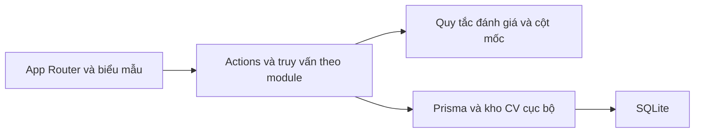

# Kiến trúc Bước Nhỏ

Các module hồ sơ, tuyển dụng, đánh giá, hành trình và cột mốc dùng chung một tiến trình Next.js. Các trang điều phối dữ liệu và giao diện. Server Actions xác thực đầu vào bằng Zod và ghi dữ liệu tại máy chủ.

MatchingService đóng gói chính sách đối chiếu. Hàm tính điểm và quy tắc chuyển trạng thái cột mốc là logic thuần, kiểm thử được mà không cần SQLite. Cấu trúc này giữ trách nhiệm riêng và cho phép thay thuật toán qua hợp đồng đầu vào và đầu ra. Các thao tác CRUD dùng Prisma trực tiếp trong lớp hạ tầng/thao tác máy chủ để giảm số lớp phải duy trì.

Kỹ năng và lịch rảnh là JSON có cấu trúc, thuộc hồ sơ duy nhất của bản demo. Kết quả lưu cả bản chụp tiêu chí để có thể xem lại sau khi sửa JD. Bản ghi tiến độ lưu lịch sử, kể cả khi cột mốc đã bị xóa. CV có mã lưu trữ riêng và metadata trong SQLite.
