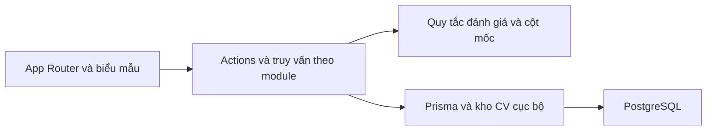

# Kiến trúc Michii

Các module hồ sơ, tuyển dụng, đánh giá, hành trình và cột mốc dùng chung một tiến trình Next.js. Các trang điều phối dữ liệu và giao diện. Server Actions xác thực đầu vào bằng Zod và ghi dữ liệu tại máy chủ.

Module `applications` bổ sung quản lý đơn ứng tuyển. `JobApplication` lưu thông tin công việc, trạng thái, lịch hẹn và ghi chú; liên kết tùy chọn một-một với `JobPosting`. `ApplicationEvent` lưu bản chụp trạng thái và ghi chú lúc tạo/đổi trạng thái trong cùng transaction. Xóa đơn cascade các sự kiện; xóa JD chỉ bỏ liên kết, giữ đơn. Ngày nộp/theo dõi là chuỗi lịch; lịch phỏng vấn chuyển từ UTC+7 sang UTC khi lưu và đổi lại khi hiển thị. Không có tác vụ gửi hồ sơ, email hay thông báo nền.

MatchingService đóng gói chính sách đối chiếu. Hàm tính điểm và quy tắc chuyển trạng thái cột mốc là logic thuần, kiểm thử được mà không cần SQLite. Cấu trúc này giữ trách nhiệm riêng và cho phép thay thuật toán qua hợp đồng đầu vào và đầu ra. Các thao tác CRUD dùng Prisma trực tiếp trong lớp hạ tầng/thao tác máy chủ để giảm số lớp phải duy trì.

Kỹ năng và lịch rảnh là JSON có cấu trúc, thuộc hồ sơ duy nhất của bản demo. Kết quả lưu cả bản chụp tiêu chí để có thể xem lại sau khi sửa JD. Bản ghi tiến độ lưu lịch sử, kể cả khi cột mốc đã bị xóa. CV có mã lưu trữ riêng và metadata trong PostgreSQL.

`jobs/extraction.ts` là bộ quy tắc thuần chạy trong trình duyệt, không dùng AI hoặc gọi mạng. Gợi ý giữ đoạn trích và yêu cầu kiểm tra; Server Action xác minh cờ `reviewed` của mọi yêu cầu có `sourceText` trước khi xác nhận JD. `JobPosting.jdText` giữ nội dung gốc. Thay đổi nội dung, nguồn hoặc trạng thái xác nhận sẽ tạo revision JD mới. JSON `MatchAssessment.items` lưu giải thích, bằng chứng hồ sơ, cách xác nhận tự động/thủ công và đoạn trích tại thời điểm đánh giá. Các trường mới là tùy chọn khi đọc bản lưu cũ để giữ tương thích.
