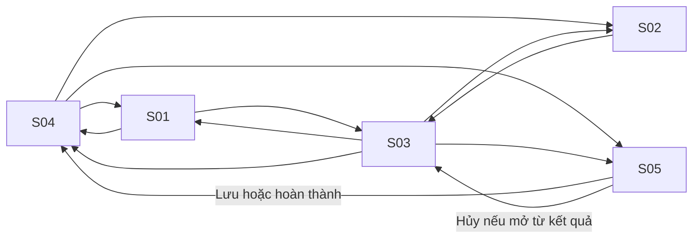

# Luồng màn hình

| Màn hình | Đường dẫn | Hành động chính |
| --- | --- | --- |
| S01 · プロフィール・スキル | `/profile` | Lưu hồ sơ về S04. Nếu mở từ S03, lưu hoặc hủy quay về kết quả tương ứng. |
| S02 · 求人情報・応募条件 | `/jobs` | Lọc, nhập hoặc sửa JD trong cùng màn hình. Xác nhận tiêu chí để mở S03. |
| S03 · 適合度の評価結果 | `/jobs/[id]/match` | Sửa yêu cầu ở S02, bổ sung hồ sơ ở S01, tạo cột mốc ở S05 hoặc xem hành trình ở S04. Có thể lưu kết quả hoặc mở URL ứng tuyển do người dùng nhập. |
| S04 · 就職活動の歩み | `/journey` | Xem điểm xuất phát, tiến độ, lịch sử và tin đã đánh giá. Mở S01, S02, S03 hoặc S05. |
| S05 · 小さな目標の詳細 | `/milestones/new`, `/milestones/[id]` | Lưu, hoàn thành hoặc xóa thì về S04. Hủy quay về S03 hoặc S04 tùy nguồn. |
| Theo dõi ứng tuyển · 応募の記録 | `/applications` | Tìm kiếm, lọc trạng thái, xem cuộc hẹn và đơn đến ngày liên hệ lại. |
| Chi tiết đơn · 応募の詳細 | `/applications/new`, `/applications/[id]` | Thêm/sửa đơn và xem lịch sử trạng thái. Có thể mở từ JD/kết quả đánh giá với thông tin điền sẵn; tin đã có đơn mở lại đơn hiện có. |

`/` hiển thị landing Michii, các CTA mở S04 hoặc trang theo dõi ứng tuyển. Bản mẫu nhanh là dialog độc lập. Tin chưa xác nhận quay về phần chi tiết S02. Đường dẫn tin hoặc cột mốc không còn hợp lệ đưa người dùng về danh sách tương ứng; đơn không tồn tại hiển thị trang 404.

