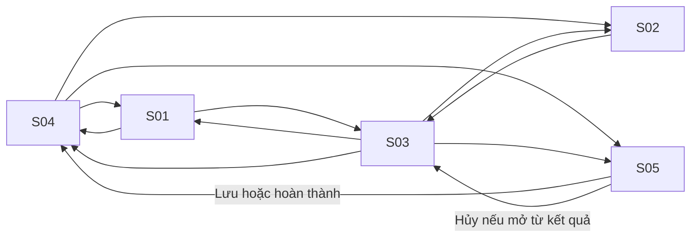

# Luồng màn hình

| Màn hình | Đường dẫn | Hành động chính |
| --- | --- | --- |
| S01 · プロフィール・スキル | `/profile` | Lưu hồ sơ về S04. Nếu mở từ S03, lưu hoặc hủy quay về kết quả tương ứng. |
| S02 · 求人情報・応募条件 | `/jobs` | Lọc, nhập hoặc sửa JD trong cùng màn hình. Xác nhận tiêu chí để mở S03. |
| S03 · 適合度の評価結果 | `/jobs/[id]/match` | Sửa yêu cầu ở S02, bổ sung hồ sơ ở S01, tạo cột mốc ở S05 hoặc xem hành trình ở S04. Có thể lưu kết quả hoặc mở URL ứng tuyển do người dùng nhập. |
| S04 · 就職活動の歩み | `/journey` | Xem điểm xuất phát, tiến độ, lịch sử và tin đã đánh giá. Mở S01, S02, S03 hoặc S05. |
| S05 · 小さな目標の詳細 | `/milestones/new`, `/milestones/[id]` | Lưu, hoàn thành hoặc xóa thì về S04. Hủy quay về S03 hoặc S04 tùy nguồn. |

`/` chuyển sang S01 nếu chưa có hồ sơ, hoặc S04 nếu đã có hồ sơ. Tin chưa xác nhận quay về phần chi tiết S02. Đường dẫn tin hoặc cột mốc không còn hợp lệ đưa người dùng về danh sách tương ứng.

